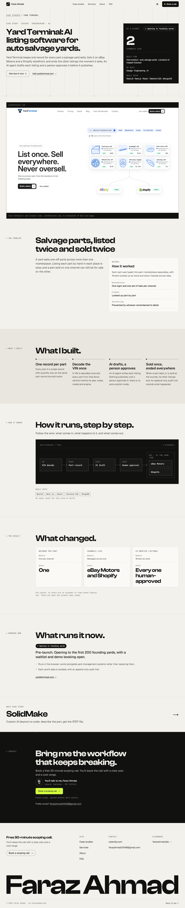
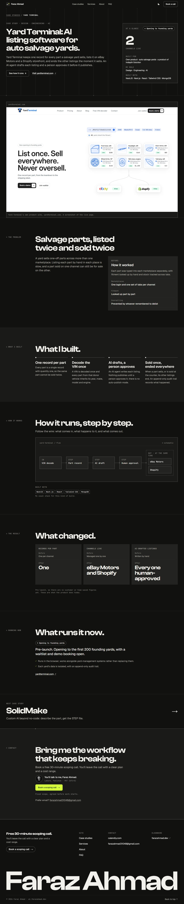
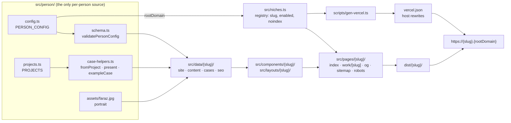

# Niche-Specific Portfolios

**Eleven niche portfolio sites from one Astro codebase: one person, one static build, one Vercel project, one subdomain per niche.**

[](https://astro.build)
[](https://www.typescriptlang.org)
[](https://nodejs.org)
[](LICENSE)
[](https://vercel.com)

## What is this

A freelancer who sells several services (AI automation, GoHighLevel, apps, cloud, funnels, paid ads, Shopify, WordPress, Webflow, SEO) gets a separate, purpose-built site per service instead of one generic portfolio. Each site has its own positioning, design, fonts and motion. They all share one identity file, one project registry, one contact form and one deploy.

It started as [Faraz Ahmad](https://farazahmad.dev)'s own set of sites (`<slug>.farazahmad.dev`). The identity and the projects now live in `src/person/`, so another person can make the whole thing theirs.

**Who it is for**

- **Freelancers and small studios** who offer several distinct services and want one focused site per buyer.
- **Developers** who want a working example of a multi-site Astro build: per-host rewrites from a registry, build-time OG images, JSON-LD, cross-document View Transitions.
- **Not for** someone who wants a theme to drop content into without reading code. The niche copy is written in the first person and has to be reviewed.

## Contents

- [Live examples](#live-examples)
- [Screenshots](#screenshots)
- [Features](#features)
- [Architecture](#architecture)
- [Quick start](#quick-start)
- [Make it yours](#make-it-yours)
- [Config reference](#config-reference)
- [Honesty and placeholders](#honesty-and-placeholders)
- [Adding a niche](#adding-a-niche)
- [Noindex switch](#noindex-switch)
- [DNS, domain and deployment](#dns-domain-and-deployment)
- [Contact form](#contact-form)
- [Rules](#rules)
- [Design notes](#design-notes)
- [Verification](#verification)
- [Troubleshooting and FAQ](#troubleshooting-and-faq)
- [Known limitations](#known-limitations)
- [Roadmap](#roadmap)
- [Contributing](#contributing) · [License](#license) · [Acknowledgements](#acknowledgements)

Long reference material (case helpers, per-niche project map, Example-mode details) is in [`docs/TEMPLATE.md`](docs/TEMPLATE.md).

## Live examples

These are the eleven niches of Faraz's reference deployment. Hosts derive from `rootDomain` in `src/person/config.ts` (`farazahmad.dev`). Every niche currently has `noindex: true` in [`src/niches.ts`](src/niches.ts), so none of them is meant to be found yet, and whether a host is reachable depends on its DNS and Vercel domain state. The names are listed as a description, not as working links.

| Slug | Host (reference deployment) | Niche | Design concept |
|---|---|---|---|
| `ai` | `ai.farazahmad.dev` | AI & Automation | Signal flow (consoles and grids) |
| `ghl` | `ghl.farazahmad.dev` | GoHighLevel | Switchboard |
| `apps` | `apps.farazahmad.dev` | App Development | Blueprint (drawing sheets) |
| `cloud` | `cloud.farazahmad.dev` | Cloud & DevOps | Uptime |
| `funnels` | `funnels.farazahmad.dev` | Marketing Automation | Flow (chat bubbles and curves) |
| `ads` | `ads.farazahmad.dev` | Paid Ads | Spend curve |
| `shopify` | `shopify.farazahmad.dev` | Shopify | Storefront |
| `wp` | `wp.farazahmad.dev` | WordPress | Editorial |
| `webflow` | `webflow.farazahmad.dev` | Webflow | Canvas |
| `seo` | `seo.farazahmad.dev` | SEO | SERP (highlighter and charts) |
| `all` | `all.farazahmad.dev` | All sites | Hub that links to the other niches |

Concepts come from [`docs/brief/README.md`](docs/brief/README.md).

## Screenshots

The `ai` niche, from [`docs/screenshots/ai/`](docs/screenshots/ai/). These show Faraz's content.

| Home, light | Home, dark |
|---|---|
|  |  |

| Case study, light | Case study, dark | Phone (390px), light | Phone (390px), dark |
|---|---|---|---|
|  |  |  |  |

Also in the folder: `case-yard-terminal-390-light.jpg` and `case-yard-terminal-390-dark.jpg`.

## Features

- **11 niches, one codebase.** Ten service niches plus the `all` hub, each with its own pages, layout, components, data, styles and assets folder.
- **A distinct design per niche.** Own display/body font pair, colour tokens and signature section. Only the footer signature font (Clash Display) and the mono font (JetBrains Mono) are shared.
- **Light and dark themes** on every niche, with a toggle stored in `localStorage('theme')` and applied by an inline `<head>` script before first paint (no flash).
- **Cross-document View Transitions** on the ten service niches (`@view-transition` in `src/styles/<slug>/base.css`). A case card morphs into its case page, and back navigation plays in reverse.
- **GSAP + Lenis motion**, loaded lazily by `<Motion />` (`src/components/shared/Motion.astro`) behind a media-query gate. It is torn down when `prefers-reduced-motion` turns on.
- **Build-time OG images** per page with [satori](https://github.com/vercel/satori) and [resvg](https://github.com/yisibl/resvg-js) (`src/lib/<slug>/og.ts`, `src/pages/<slug>/og/[slug].png.ts`), plus a generated `icon.svg` and `apple-touch-icon.png` per niche.
- **JSON-LD** in every service niche: Person, Organization, WebSite, ProfessionalService, Service, FAQPage, plus CreativeWork and BreadcrumbList on case pages (`src/lib/<slug>/jsonld.ts`).
- **SEO guard rails.** Per-page title of 60 characters or less and description of 155 or less, asserted at build time. Canonicals always point at `https://<slug>.<rootDomain>/…`.
- **A sitemap and robots.txt per niche**, generated from the registry, including dynamic case paths.
- **A noindex switch per niche**: one flag sets the robots meta tag and `robots.txt` together.
- **Honest placeholders.** A missing input renders as a dashed `TODO · …` chip, and illustrative content carries an "Example" label. Numbers, prices and testimonials are never invented ([details](#honesty-and-placeholders)).
- **One registry.** [`src/niches.ts`](src/niches.ts) drives routing, `vercel.json`, sitemaps/robots, canonicals and the `link()` helper.
- **One identity file.** [`src/person/config.ts`](src/person/config.ts) feeds names, contact details, JSON-LD and footers everywhere. It is validated at build time and by `npm run check:person`.
- **A shared contact form** that posts `FormData` cross-origin to your endpoint, with first-touch attribution (landing page, referrer, UTMs), a honeypot and a mailto fallback.
- **Accessibility measures found in the code:** a skip link in every layout, reduced-motion handling, `forced-colors` styles, and `aria-live` form status. WCAG AA contrast in both themes is a design-brief requirement. It has not been re-audited for this README.

## Architecture

### How it works

1. **One static Astro build.** Every niche builds into its own folder: `dist/<slug>/…`. There is no root page. The only root file is the shared `404.html`.
2. **Host rewrites on Vercel.** `npm run gen:vercel` (run automatically by `npm run build`) writes `vercel.json` with one rewrite per enabled niche: `<slug>.<rootDomain>/<path>` → `/<slug>/<path>`. `/_astro/` assets are excluded from the rewrite and served from the build root.
3. **Links.** `createLink('<slug>')` from `src/lib/link.ts` returns `/<slug>/about/` in dev and `/about/` in production, always with a trailing slash.
4. **Identity.** `src/person/config.ts` (`PERSON_CONFIG`) is the only place for the owner's identity. It is validated by `src/person/schema.ts`. `src/person/person.ts` exports the validated `PERSON` and Node-safe helpers (`jobTitleFor`, `bookingUrlFor`, `yearsBuilding`, `yearsPlus`, `yearsSuffix`, `FOOTER_SIGNATURE`). `src/person/profile.ts` adds the portrait image. `src/person/claims.ts` turns the optional first-person claim fields into helpers that return `undefined` or an empty list when a field is unset.
5. **Projects.** `src/person/projects.ts` (`PROJECTS`) stores each real project once, with the niches it appears on (`niches`). Each niche's `src/data/<slug>/cases.ts` builds its case studies with the helpers in `src/person/case-helpers.ts`, either from a hand-written "angle" (niche wording) or, with no code, through the niche's one adapter (`autoCases()`), which turns every project listed for the niche into that niche's own case and its "More builds" card. Screenshots are resolved by id from `src/person/assets/projects/` (`src/person/shots.ts`). The hand-written cases:
   - `fromProject('<id>', angle)` returns the case, or `undefined` when the project is absent;
   - `present([...])` drops the absent ones, keeping order; the niche's `CaseSlug` union lists the slugs it can have;
   - `exampleCase({... example: true})` declares a labelled, illustrative case;
   - `projectOrExample(id, angle, example)` falls back to a labelled example;
   - `slotsToFill(count, perRow)` counts the placeholder slots needed to complete a grid row.
6. **Example mode.** When a project a niche's angle refers to is missing from `PROJECTS`, that case, its page, its OG image and its sitemap entry are left out. Where a layout needs a fixed number of cards, a dashed TODO slot or a labelled Example case fills the gap. A niche never renders someone else's project.



### Project structure

```
.
├── astro.config.mjs            static output, trailingSlash: 'always', inline stylesheets,
│                               and a small integration that prunes unused images from the build
├── vercel.json                 GENERATED from src/niches.ts (npm run gen:vercel); committed
├── .env.development            dev-only contact endpoint (committed, no secrets); .env is optional
│                               and not in the template (create it for production overrides)
├── .env.example                documented env vars
├── (no public/ files)          the favicon is the generated route src/pages/favicon.svg.ts
├── docs/
│   ├── brief/                  per-niche content brief + DECISIONS.md (the owner's choices)
│   ├── design/  research/      design spec (ai) and verified-fact research
│   ├── todo/<slug>.md          what the owner must supply before launch, per niche
│   ├── screenshots/ai/         review screenshots
│   └── TEMPLATE.md             template reference (case helpers, Example mode, per-niche map)
├── scripts/
│   ├── gen-vercel.ts           vercel.json from the registry
│   ├── new-niche.ts            npm run new:niche
│   ├── init-person.ts          npm run init:person (writes src/person/config.ts)
│   ├── check-person.ts         npm run check:person
│   ├── review-copy.ts          npm run review:copy (reads owner-claims.json)
│   ├── owner-claims.json       first-person phrases still literal in the niche copy
│   ├── check-seo-title.ts      npm run check:seo-title
│   ├── check-claims.ts         npm run check:claims (article, years and role helper tests)
│   ├── check-links.ts          npm run check:links (broken internal links in a build)
│   ├── check-leaks.ts          npm run check:leaks (previous owner's tokens, client names)
│   ├── owner-tokens.ts         the template owner's identifiers (shared by check:leaks and check:person)
│   ├── client-blocklist.ts     client names that must never ship (check:leaks fails on any)
│   ├── template-assets.json    images that are still the template owner's (check:person warns)
│   └── templates/              *.tpl used by new:niche and init:person
└── src/
    ├── niches.ts               THE registry
    ├── person/                 config.ts, schema.ts, person.ts, profile.ts, claims.ts,
    │                           projects.ts, case-helpers.ts, shots.ts, assets/faraz.jpg,
    │                           assets/projects/<id>.png (shared, redacted screenshots)
    │                           (.backup/ holds init:person backups; git-ignored)
    ├── pages/
    │   ├── 404.astro           the one shared 404 (builds to /404.html)
    │   ├── favicon.svg.ts      the shared favicon, drawn from the owner's initials
    │   └── <slug>/             index.astro, work/[slug].astro, og/[slug].png.ts,
    │                           sitemap.xml.ts, robots.txt.ts, icon.svg.ts, apple-touch-icon.png.ts
    ├── layouts/<slug>/         Layout.astro (head, theme script, JSON-LD, nav, footer)
    ├── components/
    │   ├── shared/             ContactForm, SEO, Attribution, Motion, Todo
    │   └── <slug>/             the niche's sections
    ├── data/<slug>/            copy as data: site.ts, content.ts, cases.ts, seo.ts, profile.ts, …
    ├── lib/
    │   ├── link.ts motion.ts motion-registry.ts attribution.ts seo-files.ts
    │   ├── shared/             seo-title.ts, og-fit.ts, signature.ts, todo.ts
    │   └── <slug>/             og.ts, jsonld.ts, brand-mark.ts, base.ts, …
    ├── styles/<slug>/          tokens.css, base.css
    └── assets/
        ├── fonts/              self-hosted woff2 + og/ fonts for satori (see its README.md)
        └── <slug>/             images (astro:assets imports)
```

## Quick start

Needs Node `>=22.23.4`. The scripts are TypeScript files run directly by Node's built-in type stripping, so there is no build step for them.

```bash
git clone <your-fork-url> niche-portfolios
cd niche-portfolios
node --version        # >= 22.23.4
npm install
npm run dev           # http://localhost:4321/<slug>/  e.g. /ai/, /seo/, /funnels/
npm run build         # runs gen:vercel first, then astro build -> dist/
npm run preview       # serves dist/ (see the note below)
npm run check         # astro check (TypeScript strict)
```

- There is **no root page**, so `http://localhost:4321/` is a 404 by design. Open `/<slug>/`.
- `npm run preview` serves the production build, where links have no `/<slug>` prefix, so only use it to inspect output. Use `npm run dev` to click around.
- The contact form posts to `contactEndpoint` from `src/person/config.ts`. In dev, `.env.development` overrides it with `http://localhost:3000/api/contact`. To override it for a build, set `PUBLIC_CONTACT_ENDPOINT` in a `.env` you create (the template ships none) or in `.env.local` (git-ignored). See [Contact form](#contact-form).

## Make it yours

This is the full path from a fork to your own deployed sites. Your identity, domain, portrait, claim fields and Example mode need no change in components, styles, layouts or `src/lib/`. Two things are code steps: showing a project of your own on a niche ([step 5](#5-add-your-projects-or-run-in-example-mode)), and deleting a screenshot instead of replacing it ([step 6](#6-replace-the-project-screenshots)).

### 1. Fork or use as a template

Fork the repository (or "Use this template" on GitHub), then clone your copy and `npm install`. The `LICENSE` is MIT. The portrait and project screenshots are not covered by it (see [What stays Faraz's](#what-stays-farazs)).

### 2. Write your identity: `npm run init:person`

```bash
npm run init:person                         # asks the questions below
npm run init:person -- --from answers.json  # same, from a JSON file (field names as in the config)
npm run init:person -- --out tmp/config.ts  # dry run: write somewhere else
npm run init:person -- --print              # print the generated file, write nothing
npm run init:person -- --force              # replace the existing src/person/config.ts
npm run init:person -- --force --reset-projects   # also empty src/person/projects.ts (Example mode)
```

It asks for: name, first name, email, booking URL, root domain, main site, company, role, job title, short title line, start year, experience wording, city, country (optional), country code, location line, time-zone label, GitHub URL, LinkedIn (optional), pronouns (he / she / they / custom / leave out), tools you use (optional), contact endpoint, fallback email and portrait alt text. Defaults are offered where one can be derived, for example `mainSiteUrl` = `https://<rootDomain>`, `roleLine` = the job title, `experience` = `Since <start year>`, and `location` = `<city>, <country>` (only when you give a country; otherwise you type the location line yourself).

- **Country and location.** With `--from`, an answers file that has neither `country` nor `location` stops with exit code 1 and writes nothing. Either one is enough.
- **Validation.** Every answer is checked with the same rules as `npm run check:person` and `astro build` (`personConfigProblems` in `src/person/schema.ts`). The generated file is loaded back and validated again before anything is written.
- **Overwrites.** It **refuses to overwrite** an existing `src/person/config.ts` (exit code 1) unless you pass `--force`. With `--force` the current file is copied to `src/person/.backup/config.<timestamp>.ts` first (the folder is git-ignored). `--reset-projects` does the same for `projects.ts`. `projects.ts` is left alone by default.
- **Template.** The file is generated from `scripts/templates/person-config.ts.tpl`. Every optional claim field is in it, commented out with an explanation, so you can fill it in later.
- **`answers.json` format.** Same field names as `PERSON_CONFIG`. `sinceYear` may be a number or a string. `stack` is an array or a comma-separated string. `pronouns` is `"he"`, `"she"`, `"they"`, `"xe/xem/xyr"` or an object. Unknown fields are rejected.

**By hand instead:** edit `src/person/config.ts` directly (every field is commented), then run `npm run check:person`.

### 3. Set your domain

- `rootDomain` in `src/person/config.ts` (for example `example.dev`) feeds `ROOT_DOMAIN` in `src/niches.ts`. Every niche is then served from `https://<slug>.<rootDomain>`.
- Canonicals, sitemaps, robots.txt, JSON-LD URLs and the `vercel.json` rewrites all follow it. Run `npm run build` (or `npm run gen:vercel`) to regenerate `vercel.json`.
- DNS and Vercel are covered in [DNS, domain and deployment](#dns-domain-and-deployment).

### 4. Replace the portrait

- **The file.** `src/person/profile.ts` imports exactly `src/person/assets/faraz.jpg`. Replace that file with your own photo **under the same file name** (a JPEG), and set `portraitAlt` to describe your photo. The file name is kept for now because Astro names the built image after its source path. Renaming it means changing the import in `src/person/profile.ts` (see [Roadmap](#roadmap)).
- **One portrait only.** Every niche's About section uses that single file via `src/person/profile.ts`; there are no per-niche copies.
- **Check.** `npm run check:person` warns while the portrait is still byte-identical to Faraz's.

### 5. Add your projects (or run in Example mode)

Projects live in `src/person/projects.ts`, one record per project, keyed by `ProjectId`. A project reaches a niche in one of two ways:

- **No code: list the niche in the project's `niches`.** Seven niches (ai, apps, cloud, funnels, ghl, seo, shopify) have one adapter each (`autoCases()` in `src/data/<slug>/cases.ts`) that builds that niche's own case for every project listed for it, in registry order. The case gets a `/work/<id>/` page, an OG image, JSON-LD and a sitemap entry, and shows in the niche's "More builds" section. Per-niche wording goes in `angles.<slug>` (kicker, title, line, problem, module picks, SEO title and description); without it the canonical fields are used. ads, wp and webflow have no adapter.
- **A hand-written angle:** a `fromProject('<literal id>', angle)` block, the case's slug in the niche's `CaseSlug` union and the block in its `present([...])` list. A project with a hand-written angle in a niche is never generated there as well.

`NICHE_PROJECTS` in the same file is only a list. The ai niche uses it for the company line (`COMPANY_PROJECT_NAMES`), `npm run check:person` reads it, and comments refer to it. It does not decide what renders. The hand-written angles are written for Faraz's six original ids (`ai-seo-automator`, `yard-terminal`, `solidmake`, `lead-drift`, `farazahmad-dev`, `lead-pipeline`); his other projects render through the adapters. Which niche shows which project, the new fields and the no-code steps are in [`docs/TEMPLATE.md`](docs/TEMPLATE.md#which-niche-uses-which-project) and [Add a project with no code](docs/TEMPLATE.md#add-a-project-with-no-code).

**What works without code: Example mode.** Run `npm run init:person -- --force --reset-projects`, or set `PROJECTS = {}` yourself. Keep the ids in the `ProjectId` union: the niches' code passes the original six to `fromProject` / `getProject` / `hasProject`, so removing one makes `npm run check` (astro check) fail. Every niche then leaves out the project cases (hand-written and generated; the "More builds" sections render nothing) and shows dashed `TODO ·` slots and its labelled Example cases instead ([Example mode](#example-mode)).

**Reusing one of the six ids.** A record under an existing id renders through that niche's hard-coded angle. The registry values are used where the angle reads them (name, link, status, stack, facts, modules, `madeBy`, …), but the angle's own wording, sample figures and measured numbers still print Faraz's claims. Examples: funnels' lead-sources line ("Google Maps and Apollo", corrected after the 2026-11 code scan), the ai lead-drift headline figure and its "Before: …" baseline story, the apps and seo Lighthouse figures and dates of his own site, and cloud's "(Oct 2026)". These are tracked in `scripts/owner-claims.json` and listed by `npm run review:copy` ([step 8](#8-review-the-remaining-first-person-copy)). Reuse an id only if your project really fits that case, then rewrite the angle text.

An angle **throws at build time** when it reads a key your record lacks. The messages (from `src/person/case-helpers.ts`):

- `[projects] <id> has no fact "<key>"` (from `fact(p, key)`)
- `[projects] <id> has no module "<module id>"` (from `modules(p, [...])`)
- `[projects] <id> has no "madeBy" (the angle names the company that makes it)` (from `madeBy(p)`)

`npm run check:person` warns about these ahead of the build, best effort (a regex over the `fromProject` blocks, not the TypeScript). The keys each id needs are listed per id in [`docs/TEMPLATE.md`](docs/TEMPLATE.md#keys-each-angle-reads).

**A project with a new id needs no code.** Steps:

1. **Add the id to the `ProjectId` union** in `src/person/projects.ts`. Without it, `npm run check` reports type errors on the record (an unknown key in `PROJECTS`, an `id` that is not a `ProjectId`). `astro build` does not type-check, so it still builds.
2. **Add the record** to `PROJECTS` (example below), in the order you want the cards: generated cases follow registry order.
3. **List its niches** in `niches`, and optionally word it per niche in `angles.<slug>`.
4. **Optionally add a screenshot** (redacted) as `src/person/assets/projects/<id>.png` and set `screenshot.alt` ([step 6](#6-replace-the-project-screenshots)).

Each listed niche with an adapter then shows it in its "More builds" section, with a case page, OG image, JSON-LD and sitemap entry. Write a hand-written `fromProject()` angle only when a niche must say something the generated case cannot (model it on `src/data/wp/cases.ts`, the smallest; add the slug to `CaseSlug` and the block to `present([...])`). Hand-written cases go in the main grid, and some components branch on their fixed ids or positions: the wp home row shows only the first non-example case (`CASES.find((c) => !c.example)` in `src/components/wp/Cases.astro`), funnels' main card is `MAIN_CASE` (`'lead-drift'`), `src/data/apps/content.ts` prefers the `solidmake` case for its hero, and `src/components/seo/Cases.astro`, `src/components/funnels/Cases.astro` and `src/components/apps/Cases.astro` render some ids differently. The niches' tuned card-to-page transition rules in `src/styles/<slug>/base.css` list the original case slugs by name, so a new slug gets the niche's default transition instead (the `view-transition-name: case-<id>` itself is set inline from the id).

```ts
// src/person/projects.ts (placeholder values; every value must be a verified fact)
export type ProjectId =
  | 'ai-seo-automator' | 'yard-terminal' | 'solidmake' | 'lead-drift' | 'farazahmad-dev' | 'lead-pipeline'
  | /* … */ 'my-tool';

export const PROJECTS: Readonly<Partial<Record<ProjectId, Project>>> = {
  'my-tool': {
    id: 'my-tool',
    name: 'Your Product Name',
    kind: 'product',
    ownership: 'own',
    niches: ['apps', 'cloud'], // generated on both, no code
    client: 'Own product · <who it is for>',
    // status: left out = unknown, the generated case leaves it out
    live: false,
    link: { label: 'example.com', href: 'https://example.com' },
    summary: 'Two or three sentences that are true wherever the project is shown.',
    stack: { items: ['Next.js', 'MongoDB'], provisional: false },
    modules: [{ id: 'publish', title: 'Written and published', text: 'What this part does.' }],
    facts: {},
    notes: ['A caveat every case page must show, if there is one.'],
    angles: {
      apps: { kicker: 'Own product · SaaS', seoTitle: 'Your Product: a Publishing SaaS', seoDescription: 'Case study: …' },
    },
    sources: ['where these facts come from (never rendered)'],
  },
};
```

`npm run check:person` warns about a registered id that is not in the `ProjectId` union or that no niche shows, a `niches` entry that is unknown or will not render (ads, wp and webflow have no adapter), an `angles` key missing from `niches`, and a module pick the record lacks.

About the file headers: `src/person/projects.ts` says "extend `ProjectId` with your own ids", and the reset template (`scripts/templates/person-projects.ts.tpl`) says "keep these". The code needs both: keep the ids the hand-written angles name, and add yours.

<details>
<summary><strong>Project field reference</strong> (from <code>src/person/projects.ts</code>)</summary>

| Field | Type | Required | What it is |
|---|---|---|---|
| `id` | `ProjectId` | yes | Same as the record key; the default case slug in the niches. |
| `name` | string | yes | Display name, exactly as written everywhere. |
| `cardTitle` | string | no | Card and page heading when it differs from `name`. |
| `kind` | `'product' \| 'internal' \| 'research' \| 'own-site' \| 'system' \| 'client'` | yes | `own-site` = your own website (found by `findOwnSite()`); `system` = subsystem of `partOf`; `client` = built for a client, never named. |
| `ownership` | `'own' \| 'client'` | no | Client work gets a "Confidential client" treatment unless it is named on purpose. |
| `niches` | `NicheSlug[]` | no | The niches it appears on; drives the generated cases. |
| `proof` | `'strong' \| 'partial' \| 'weak'` | no | Evidence strength; niches may order or size cards by it. |
| `angles` | `Partial<Record<NicheSlug, ProjectAngle>>` | no | Per-niche wording for the generated case: `kicker`, `title`, `line`, `problemTitle`, `problemText`, `modulePicks`, `seoTitle`, `seoDescription`. |
| `notes` | string[] | no | Caveats every niche prints on the case page. |
| `repo` | `{ label, href }` | no | Public source repository, rendered only where present. |
| `partOf` | `ProjectId` | no | Parent project, for a `system`. A hand-written case of a `system` stands for its parent on that niche (the parent is not generated there). |
| `role` | string | no | Role tags, e.g. "Design · Engineering · AI". |
| `client` | string | no | Who it is for, one line. |
| `status` | string | no | Verified status label. Absent = unknown: niches show a TODO chip. |
| `live` | boolean | yes | `true` only when confirmed live in production. |
| `link` | `{ label, href }` | no | Public link. |
| `summary` | string | no | Canonical two- or three-sentence description. |
| `stack` | `{ items: string[], provisional: boolean }` | no | `provisional: true` while it is your default stack, not confirmed per project. |
| `modules` | `{ id, title, text }[]` | no | Canonical "what I built" list; niches pick by `id`. |
| `flow` | string[] | no | Canonical flow (diagram nodes). |
| `facts` | `Record<string, string>` | yes (may be `{}`) | Short verified one-liners, picked by key with `fact(p, key)`. |
| `screenshot` | `{ alt, copies?: string[] }` | no | Alt text. The file is `src/person/assets/projects/<id>.<ext>` (shared), or older per-niche copies listed in `copies`. |
| `madeBy` | string | no | The company behind it, when it is a company product. |
| `toolName` / `toolText` | string | no | Name and caption clause of the project's internal tool. |
| `sources` | string[] | yes | Where the facts come from. Documentation only, never rendered. |

</details>

### 6. Replace the project screenshots

**Shared folder (new projects).** One file per project id in `src/person/assets/projects/<id>.<png|jpg|jpeg|webp>`, found by `projectShot(p)` in `src/person/shots.ts` (an eager `import.meta.glob`, Astro only) when the project also has `screenshot.alt`. Every niche uses it, so a screenshot needs no per-niche copy or import: add the file, set the alt text, done. Delete or replace Faraz's files there (`check:person` lists them while they are still his). **Redact before a file goes in**: no client brand, file names, host names or people; Faraz's were redacted with a script and checked by eye, and the alt text says what is blurred. Figures shown inside a screenshot (a mock-up dashboard, run counts) are never quoted in copy. Files no built page uses are removed by `prune-unused-images` after the build.

**Older per-niche copies.** Faraz's first screenshots are still imported per niche from `src/assets/<slug>/`:

| File | Imported by |
|---|---|
| `src/assets/ai/cases/yard-terminal-site.png` | `src/data/ai/cases.ts` |
| `src/assets/apps/yard-terminal-site.png` | `src/data/apps/cases.ts` |
| `src/assets/ai/leadrift.png` | `src/pages/ai/work/[slug].astro` |
| `src/assets/funnels/leadrift.png` | `src/pages/funnels/work/[slug].astro` |
| `src/assets/apps/leadrift.png` | `src/components/apps/Cases.astro` |

They are Faraz's images. The imports are static, so deleting a file breaks the build unless you also remove its import and the code that uses it. Either replace each file with your own screenshot of the matching project (same name), or remove the import together with that block. With a project absent the screenshot block is not rendered, and the imported file is then removed from the build (see [Example mode](#example-mode)). `npm run check:person` warns while a screenshot is still byte-identical to Faraz's (the list is `scripts/template-assets.json`), and `npm run check:leaks` reports build file names that contain the old project names (class `asset-name`). The portrait's built files (`_astro/faraz.<hash>.<ext>`, and any build file name containing "faraz") are reported in their own class, "asset file name (portrait keeps the source name)", which does not fail `--strict` (see [step 4](#4-replace-the-portrait)).

### 7. Fill the claim fields (or leave them out)

The niche copy is first-person ("I'm …, I build …"). The claim fields in `src/person/config.ts` decide what the copy may say about you. **Unset never prints the previous owner's wording**: the clause is dropped, neutral wording is used, or a TODO chip shows.

| Field | Example | When unset |
|---|---|---|
| `firstName` (required) | `'Ada'` | Required: names are not split automatically. |
| `shortName` | `'Ada'` | Uses `firstName` (the ai comparison column "Me (…)"). |
| `pronouns` | `{ subject: 'she', object: 'her', possessive: 'her' }` | they / them / their. |
| `stack` (required, may be `[]`) | `['n8n', 'Python']` | `[]` = no tool claims: tool lists become TODO chips, tool-naming sentences drop out. A niche's own platform (Webflow on webflow, …) always shows. Names must match the niches' lists in `src/data/<slug>/site.ts` exactly. |
| `profession` | `'full-stack engineer'` (lowercase) | Clauses like "I'm a full-stack engineer, so …" are left out. |
| `seniority` | `'senior'` (lowercase) | No adjective ("an engineer"). |
| `careerLine` | one sentence | The apps About sentence is left out. |
| `experienceShort` | `{ value: '5+ yrs', label: 'Of …' }` | The apps proof cell is a TODO chip. |
| `credentials` | `{ googleAdsPartner: false, metaPartner: false, webflowCertifiedPartner: true }` | Per key: `true` = "Yes" wording, `false` = "No, I hold no …" wording, **absent = unknown**: that FAQ entry (and its FAQPage JSON-LD entry) and any About note are left out. Never set `true` without proof. |
| `originStories` | `{ seo: 'I came to SEO from the code side.' }` or `{ ghl: { text, title } }` | That niche's About drops the sentence and uses neutral title wording. Keys must be niche slugs. |
| `contactFeedsCrm` | `true` | A plain "on its way" success message instead of "into my CRM". |
| `supportHours` | `'9AM–5PM CET'` | The cloud support-hours lines (nav, footer, final CTA, hero, About, JSON-LD) are left out and the copy says "business hours" without a time. |

### 8. Review the remaining first-person copy

```bash
npm run review:copy             # report, exit 0
npm run review:copy -- --strict # exit 1 while any registered phrase is still present
```

`scripts/owner-claims.json` lists the phrases that are still written literally in the niche copy because they are true for Faraz. Each has a kind: `claim` (a fact about him), `tools`, `stance`, `positioning`, `metric` (a measured figure or measurement date of his own project) and `project-wording` (his project described literally in an angle, which prints for anyone who registers a project with that id). For each one the report prints the files it is in, why it is a claim, and how to fix it. Rewrite or delete each one in `src/data/<slug>/content.ts` / `cases.ts`. An entry turns `STALE` when its phrase is gone; then remove the entry.

- **What is scanned.** Every text file under `src/` except `src/person/` (config, projects and the `.backup/` copies are your own data). A phrase found only in comments is flagged `[only in comments: reword the comment]`: it renders nowhere.
- **`--strict` in CI.** With Faraz's copy every registered phrase is present, so `--strict` fails. It passes only after you have replaced or removed every registered phrase (stale entries do not fail it), so add it to CI after that review, not before.

The service copy itself ("I build …", offers, FAQs) is the niche template. It stays, but read it as your own pitch before you launch.

### 9. Fix the TODO chips and placeholders

- **In the source:** search `src/` for `TODO ·` (literal chips and slots) and for `todo(` (the `todo()` fields of ai, cloud, seo and apps).
- **In a build:** search `dist/` HTML for `data-todo` (chips whose `TODO ·` prefix is drawn by CSS) and for `TODO ·`.
- **Per-niche lists:** `docs/todo/<slug>.md` lists what Faraz still had to supply per niche. Rewrite these files for yourself or delete them.
- **Illustrative figures:** the ai niche shows some `sample('id', 'value')` figures in `src/data/ai/cases.ts`, with an "illustrative figures" note on the page. They never reach meta tags, OG images or JSON-LD. The build refuses to run with `noindex: false` while any remain (`assertLaunchReady` in `src/data/ai/todo.ts`). Cloud has a similar guard for a different thing: `src/data/cloud/todo.ts` fails the build with `noindex: false` while any TODO value remains in the data it is given.

### 10. Check everything

```bash
npm run check:person     # validates config.ts, lists hard-coded owner strings (yours, and the template owner's fixed list) and what is still the old owner's
npm run check:claims     # article / years / role helper tests
npm run check:seo-title  # title and description helper tests, plus a lint of the case meta
npm run check            # astro check (TypeScript)
npm run build            # regenerates vercel.json, builds dist/
npm run check:links      # broken internal links in dist/ (--dir <build dir> for another folder)
npm run check:leaks      # the previous owner's name, places and project names in dist/; fails on any client name
npm run check:leaks -- --src --strict   # also scan src/; exit 1 on any hit except dead CSS selectors and portrait file names
```

- **`check:person`** exits 1 on an invalid config; everything else it prints is a report or a warning. It lists hard-coded copies of the current identity in `src/`, and, with a fixed list of the template's original owner's identifiers (`scripts/owner-tokens.ts`: Faraz, farazahmad, Lahore, Indepth, his project names, …), the leftovers of HIS identity that `init:person` cannot rewire (WARN, with `file:line`; comments, a few gated claims such as cloud's owner-stack lines, and counts for the case/content files that hold his case copy). The fixed list is searched even after the config changed, and is skipped only for a config that is his own. It then prints "first-person claims to review": every claim field with its value or `(unset)` (including `supportHours`; an empty `stack` prints `[]`) and the count of registered literal claims still in `src/`. It warns about each project in `src/person/projects.ts` that is not in the `ProjectId` union or that no niche refers to, and, best effort, about each fact / module / `madeBy` a niche angle reads that the project lacks ([step 5](#5-add-your-projects-or-run-in-example-mode)). It also warns while a template default image listed in `scripts/template-assets.json` (the portrait, the project screenshots) is still byte-identical, and when a `PUBLIC_CONTACT_*` value in `.env`, `.env.production` or `.env.development` points off your `rootDomain` (localhost is fine).
- **`check:claims`**, **`check:seo-title`** and **`review:copy`** are the quick checks for the wording helpers, the meta helpers and the remaining first-person phrases ([step 8](#8-review-the-remaining-first-person-copy)).
- **`check:leaks`** uses Faraz's identity and project names as its default token list. Pass your own with `--tokens "Name,domain.dev"` or `--tokens-file <file>` (one token per line, `#` starts a comment). `--tokens-file` is resolved against the folder you ran npm from; `--dir` is resolved against the repository root. `--strict` exits 1 on any hit except dead view-transition selectors and the portrait file-name class.
- **Client names (always on).** Every `check:leaks` run also scans the build (text and file names) and all of `src/` (including `src/person/` and file names) for the names in `scripts/client-blocklist.ts`, case-insensitively and word-bounded, and exits 1 on any hit, with or without `--strict`. The list stays in `scripts/` so it never ships. Replace it with your own clients' names.
- **`check:leaks --strict` in Example mode.** With Faraz's identity still in `src/person/config.ts`, his name and domain render on every page, so the default token list always finds them and `--strict` fails. Run it after you have replaced the identity, or pass `--tokens-file` with project tokens only to check Example mode on its own.

### 11. Contact form endpoint

Set `contactEndpoint` and `contactFallbackEmail` in `src/person/config.ts`; that is enough. The optional env vars `PUBLIC_CONTACT_ENDPOINT` / `PUBLIC_CONTACT_EMAIL` win when set, to override per environment. The template ships no `.env`, so nothing overrides the config until you create one. `.env.development` sets `PUBLIC_CONTACT_ENDPOINT=http://localhost:3000/api/contact` for `npm run dev` only. If you uncomment a line in `.env`, use your own value: `npm run check:person` warns when it points off your root domain. The endpoint must answer cross-origin: see [Contact form](#contact-form).

### 12. Enable niches, go live, deploy

1. Decide which niches you want. A niche with `enabled: false` in `src/niches.ts` gets no host rewrite in `vercel.json` and drops out of the `all` hub. Astro still builds its `src/pages/<slug>/` folder (the pages do not read the flag), so delete a niche's folders if you want it gone from `dist/` entirely.
2. Deploy to Vercel (see [deployment](#dns-domain-and-deployment)) and add one domain + one CNAME per enabled niche.
3. When a niche is ready to be found, set `noindex: false` for it in `src/niches.ts` and redeploy.

### What you do not need to touch

For identity, domain, portrait, claim fields, Example mode and new projects listed by `niches`, `src/components/`, `src/layouts/`, `src/styles/`, `src/lib/` and the page routes read everything through `src/person/` and `src/niches.ts`. Text changes happen in `src/data/<slug>/` (or in a project's `angles`). This does not hold for new hand-written angles: some components branch on fixed project ids and the case transition rules in `src/styles/<slug>/base.css` list the original slugs by name ([step 5](#5-add-your-projects-or-run-in-example-mode)). Design changes (fonts, colours, sections) are optional, and are the normal Astro work in the niche's own folders.

### What stays Faraz's

- **The copy.** The niche copy is written in the first person for a full-stack / automation freelancer. Identity, projects and the claim fields above are wired to `src/person/`. The remaining literal claims are tracked in `scripts/owner-claims.json` (`npm run review:copy`). The rest is service copy you are expected to read and adapt.
- **The images.** The portrait (`src/person/assets/faraz.jpg`) and the project screenshots in `src/assets/<slug>/` are Faraz's personal images. They are **not licensed for reuse**: replace them.
- **The docs.** `docs/brief/`, `docs/research/`, `docs/design/`, `docs/todo/` and `docs/screenshots/` are Faraz's briefs, research, decisions and review images. Replace them with your own or delete them.

## Config reference

### `PERSON_CONFIG` (`src/person/config.ts`, shape in `src/person/schema.ts`)

<details open>
<summary><strong>Identity and contact fields</strong></summary>

| Field | Type | Required | Feeds | When unset / rules |
|---|---|---|---|---|
| `name` | string | yes | JSON-LD `Person.name`, title/OG suffixes, bylines, nav marks, footers, the `ghl` registry name | — |
| `firstName` | string | yes | "I'm …", "Me (…)" | Not derived from `name`. |
| `shortName` | string | no | The ai comparison column | Defaults to `firstName`. |
| `email` | string | yes | Every niche's `CONTACT_EMAIL`: mailto links, JSON-LD email | Must look like `name@example.com`. |
| `bookingUrl` | string | yes | Booking buttons; `bookingUrlFor(slug)` adds `utm_source=<slug>` (+ `utm_content`) | https only. |
| `company` | string | yes | `BRAND_COMPANY`, `PROFILE.company`, JSON-LD `worksFor` | — |
| `companyRole` | string | yes | `PROFILE.companyRole` | — |
| `sinceYear` | number | yes | `PROFILE.sinceYear`, `yearsBuilding()` | Whole year, 1950 to the current year. |
| `experience` | string | no | apps `PROFILE.experience` (About "Experience" row) | Unset: the apps Experience row is left out. See the type-check note below the table. |
| `city` | string | yes | `PROFILE.city`, JSON-LD address | — |
| `country` | string | no | ai `PROFILE.country`, which nothing renders | Only the `init:person` default for `location` uses it. See the type-check note below the table. |
| `countryCode` | string | yes | JSON-LD `addressCountry` | Two uppercase letters (ISO 3166-1). |
| `location` | string | yes | `PROFILE.location` | — |
| `timeZone` | string | yes | `PROFILE.timeZone` | Free text, e.g. `CET (UTC+1)`. |
| `github` | string | yes | `PROFILE.github`, JSON-LD `sameAs` | https only. |
| `linkedin` | string | no | Nothing renders it yet | https only when set. |
| `rootDomain` | string | yes | `ROOT_DOMAIN` in `src/niches.ts`: canonicals, sitemaps, robots, `vercel.json`, origins | Bare lowercase hostname: no protocol, path, port or trailing dot. |
| `mainSiteUrl` | string | yes | `MAIN_SITE_URL`, footer "Elsewhere" links, the `all` hub | https, **no trailing slash**. |
| `contactEndpoint` | string | yes | Contact form POST target | https. `PUBLIC_CONTACT_ENDPOINT` overrides it when set. |
| `contactFallbackEmail` | string | yes | Contact form mailto fallback | `PUBLIC_CONTACT_EMAIL` overrides it when set. |
| `footerSignature` | string | no | The big display signature in the footers | Defaults to `name`. Set a shorter form for a long name. |
| `roleLine` | string | no | ai `PROFILE.roleLine`, which nothing renders | Read but not rendered. See the type-check note below the table. |
| `jobTitle` | string | yes | `PROFILE.jobTitle`, JSON-LD `jobTitle` | — |
| `supportHours` | string | no | Cloud only: the hours lines in Nav, Footer, FinalCta, About, Hero and the JSON-LD description, and the hours in the care-plan and FAQ copy | Hours you offer support in, as the copy prints them, e.g. `9AM–5PM CET`. Unset: the hours lines are left out and the copy says "business hours" without a time. |
| `jobTitleByNiche` | `Record<slug, string>` | no | Per-niche job title overrides | Keys must be niche slugs. Unset: every niche uses `jobTitle` (`jobTitleFor()` falls back to `{}`). |
| `portraitAlt` | string | yes | Alt text of the portrait | Describe the actual photo. |

The claim fields (`pronouns`, `stack`, `profession`, `seniority`, `careerLine`, `experienceShort`, `credentials`, `originStories`, `contactFeedsCrm`, `supportHours`) are in [step 7](#7-fill-the-claim-fields-or-leave-them-out).

</details>

**Type-check note.** `config.ts` ends in `satisfies PersonConfig`, so `PERSON` has the exact shape you wrote. `src/data/ai/profile.ts` reads `PERSON.roleLine` and `PERSON.country`, and `src/data/apps/profile.ts` reads `PERSON.experience`, directly. If you leave one of these three lines out, the schema and `astro build` accept it, but by TypeScript's rules `npm run check` reports "Property '…' does not exist" in that file (checked on a minimal reproduction of this pattern, not by running `astro check` on this repository). `init:person` always writes `roleLine` and `experience` (it has defaults for both), but leaves `country` out when you answer blank. `jobTitleByNiche` and the claim fields are read through the `PersonConfig` type, so leaving them out is safe for the type check too.

### Environment variables (`.env.example`)

Both variables are optional overrides. Unset (or empty) means the value from `src/person/config.ts` is used.

| Variable | Used by | When unset |
|---|---|---|
| `PUBLIC_CONTACT_ENDPOINT` | `src/components/shared/ContactForm.astro`: where the form POSTs | `contactEndpoint` from `src/person/config.ts`. |
| `PUBLIC_CONTACT_EMAIL` | The form's mailto fallback when the endpoint cannot be reached | `contactFallbackEmail` from `src/person/config.ts`. |

Files: `.env` (optional, not in the template: create it for production-build overrides, public values only), `.env.development` (`astro dev`, committed; the localhost endpoint), `.env.local` / `.env.*.local` (local overrides, git-ignored). Every `PUBLIC_` variable is shipped to the browser: **no secrets**.

### npm scripts

| Script | What it does |
|---|---|
| `npm run dev` | `astro dev`. Open `http://localhost:4321/<slug>/`. |
| `npm run build` | `gen:vercel`, then `astro build` → `dist/`. |
| `npm run preview` | `astro preview` of `dist/` (links have no `/<slug>` prefix). |
| `npm run check` | `astro check` (TypeScript strict). |
| `npm run gen:vercel` | Writes `vercel.json` from `src/niches.ts`. Fails if an enabled niche has no `src/pages/<slug>/index.astro`. |
| `npm run new:niche <slug> ["Name"]` | Scaffolds a niche from `scripts/templates/` ([Adding a niche](#adding-a-niche)). |
| `npm run init:person` | Writes `src/person/config.ts` from your answers ([step 2](#2-write-your-identity-npm-run-initperson)). |
| `npm run check:person` | Validates the identity, reports hard-coded owner strings (the current identity's, and a fixed list of the template owner's identifiers still in `src/`: WARN with `file:line`), prints the first-person claims to review (every claim field, the count of literal phrases), warns about projects not in the `ProjectId` union or used by no niche, best-effort checks the fact / module / `madeBy` keys the angles read, and warns about template default images (`scripts/template-assets.json`) and `PUBLIC_CONTACT_*` env overrides that point off your root domain. Exit 1 on an invalid config only. |
| `npm run check:claims` | Tests for the wording helpers: `withArticle` ("an hour", "a user", "an SEO engineer"), `yearsPlus` / `yearsSuffix` (no "0+ years"), `roleInSentence`, `ROLE_IN_SENTENCE` and `FOUNDED_VERB` for your `companyRole`. |
| `npm run review:copy` | Lists the registered first-person phrases still in `src/` (`--strict` exits 1 while any remain). |
| `npm run check:seo-title` | Tests for the `<core> \| <name>` title helper (long-name fallback) and `fitDescription`, and a lint that fails when a case title or description in `src/data/<slug>/cases.ts` interpolates a value without `fitDescription`. |
| `npm run check:links` | Broken internal links in a build (`--dir`, `--domain`). Exit 1 when any is missing. |
| `npm run check:leaks` | The previous owner's tokens in a build (`--dir`, `--src`, `--tokens`, `--tokens-file`, `--ignore-case`, `--strict`). `--strict` exits 1 on any hit except dead CSS selectors and portrait file names. Always exits 1 on a client name from `scripts/client-blocklist.ts` in the build or `src/`. |
| `npm run astro` | The Astro CLI. |

## Honesty and placeholders

The hard rules the copy was written under. The full list, with where each rule comes from, is in [`docs/TEMPLATE.md`](docs/TEMPLATE.md#honesty-rules).

- **Never invent** numbers, prices, testimonials, client names, rankings or credentials. Prices read "Scoped on a call" and testimonials are omitted. New work adds no price, savings or leak calculators: cloud, webflow and ads had theirs removed. The funnels leak calculator (`src/components/funnels/LeakCalc.astro`, labelled as an estimate, as `docs/brief/DECISIONS.md` › funnels decided) is still on the funnels home page.
- **A missing input is visible.** It renders as a dashed, hatched `TODO · <what is missing>` chip (`src/components/shared/Todo.astro` with `orTodo()` from `src/lib/shared/todo.ts`; ai, cloud and seo have their own Todo components).
- **Illustrative content is labelled.** Example people and businesses are allowed when labelled, and example cases carry an "Example" stamp (`exampleCase()` makes that a type-level requirement). Illustrative figures in the ai niche carry a page note and are kept out of meta tags, OG images and JSON-LD.
- **Machine-readable output stays factual.** JSON-LD and OG images only use real values.
- **An unset claim field never prints the previous owner's wording** (`src/person/claims.ts`).

### Example mode

When a project that a niche's angle names (`fromProject('<id>', …)`) is missing from `PROJECTS`:

- **Disappears:** that case card, its `/work/<id>/` page, its OG image and its sitemap entry. Copy elsewhere in the niche that names the project (proof strips, About lines, FAQs, hero buttons) is gated with `getProject()` / `hasProject()`. Run `npm run check:leaks` after a build to confirm that nothing slipped through.
- **Turns into a dashed slot:** a grid position the layout needs to keep rows complete (`slotsToFill()`, used in ads, cloud, apps, funnels, ghl, shopify and `src/lib/cloud/tools.ts`), or a niche's fixed "own project" slot. The slot constants per niche are listed in [`docs/TEMPLATE.md`](docs/TEMPLATE.md#example-mode-in-detail).
- **Stays as a labelled Example:** the niche-only example cases (`exampleCase()`) keep rendering with their "Example" stamp. `projectOrExample()` can also swap a missing project for a labelled example, but no niche uses it yet.

**Unused screenshots do not ship.** The project screenshots are imported statically, so Astro emits them even when their project is absent. A small integration in `astro.config.mjs` (`prune-unused-images`) deletes, after the build, any emitted image that no page, stylesheet or script references and that has no resized copies. A build that renders every import is left exactly as it was. The log prints `removed unused image …` for each file it deletes.

Per-niche details and leftovers: [`docs/TEMPLATE.md`](docs/TEMPLATE.md#example-mode-in-detail).

### Long names

- **Page titles** use `withNameSuffix(core, name)` (`src/lib/shared/seo-title.ts`). The suffix is `<core> | <full name>` when it fits 60 characters, otherwise `<core> | <first word>`, otherwise `<core>` alone. Titles are never truncated: a core that cannot fit fails the build with the niche's normal title-length error. `npm run check:seo-title` tests this with a 29-character name.
- **Case titles and descriptions** that interpolate a project, company or person name go through `fitDescription(max, …variants)` (same file): the first variant that fits wins, shorter variants drop a clause, and nothing is truncated. When no variant fits, the last one is returned unchanged and the build fails with the normal length error. `npm run check:seo-title` fails on an interpolated case title or description that skips it.
- **Footer signature.** `signatureStyle()` (`src/lib/shared/signature.ts`) shrinks the footer signature in proportion to its length for names over 11 characters. You can also set a shorter `footerSignature`.
- **OG cards.** `fitSignatureRow()` (`src/lib/shared/og-fit.ts`), used by the signature row of every niche's OG cards (ads, ai, apps, cloud, funnels, ghl, seo, shopify, webflow, wp), drops the decorative tagline first, then shrinks the name. Widths are estimated per character, not measured. Other OG lines that interpolate a name (e.g. the wp masthead, the apps "Drawn by" line) have no length guard (see [Known limitations](#known-limitations)).

## Adding a niche

```bash
npm run new:niche <slug>                  # slug already in src/niches.ts
npm run new:niche <slug> "Display Name"   # brand-new slug: also appends it to the registry
```

It sets `enabled: true` (noindex stays ON), creates `src/pages/<slug>/`, `src/layouts/<slug>/` and `src/assets/<slug>/` from `scripts/templates/`, and never overwrites existing files. Then:

1. `npm run build` (regenerates `vercel.json`; `gen:vercel` fails fast if an enabled niche has no `src/pages/<slug>/index.astro`).
2. Do the [DNS step](#dns-domain-and-deployment).
3. When the niche is ready to be found, set `noindex: false` for it.

By hand it is the same thing: set `enabled: true` in `src/niches.ts` and copy the three folders from an existing niche, replacing the slug inside the files. The scaffold is a placeholder page; the existing niches add `src/components/<slug>/`, `src/data/<slug>/`, `src/lib/<slug>/` and `src/styles/<slug>/` on top (use `funnels` as the reference implementation).

## Noindex switch

Every niche has `noindex: true` in `src/niches.ts` by default. While it is on, that niche:

- puts `<meta name="robots" content="noindex">` on every page (via `<SEO />`), and
- serves a `robots.txt` with `Disallow: /` (and no `Sitemap:` line).

Set `noindex: false` to go live: the meta tag disappears, and `robots.txt` allows everything and lists the sitemap. A single page can also opt out with `noindex` on its `Layout`/`SEO` props.

Note: a `Disallow` in `robots.txt` stops crawlers from reading the page, so they never see the `noindex` tag. Together they keep a niche out of crawls, but URLs linked from elsewhere can still show up in results without content. Both are controlled by the one flag; turn it off before launching.

Optional per niche: render `<Motion />` (from `components/shared/Motion.astro`) in the layout to turn on Lenis + GSAP ScrollTrigger. Niches that don't render it never download them. It does nothing under `prefers-reduced-motion`. Use `getMotion()` from `src/lib/motion.ts` to reach the `gsap`, `ScrollTrigger` and `lenis` instances.

## DNS, domain and deployment

**One Vercel project serves every niche.**

1. Import the repository in Vercel with the Astro framework preset: build command `npm run build`, output directory `dist`, Node.js 22 or later (`engines` in `package.json` asks for `>=22.23.4`). The committed `vercel.json` carries the host rewrites.
2. **Per niche**, in Vercel: Project → Settings → Domains → add `<slug>.<rootDomain>`.
3. **Per niche**, at your DNS provider (Faraz uses Spaceship for `farazahmad.dev`): add a **CNAME** record with host `<slug>` and the target Vercel shows for that domain. Vercel's generic target is `cname.vercel-dns.com`; use the one Vercel displays.
4. Wait for Vercel to show the domain as valid. SSL is issued automatically.

The rewrite for the host already exists in `vercel.json` once the niche is enabled and the build has run. `vercel.json` is generated and committed: don't edit it by hand; edit `src/niches.ts` (or `rootDomain`) and rebuild.

## Contact form

`<ContactForm niche="ai" />` POSTs `FormData` cross-origin straight to the endpoint (no Vercel proxy) with: `name, email, message, niche, company` (honeypot), `elapsed`, `ft_page, ft_landing, ft_referrer, ft_utm_source, ft_utm_medium, ft_utm_campaign`.

First-touch attribution (landing path, referrer, UTMs) is saved in `sessionStorage` on the visitor's first page view of the session (done by `<SEO />`) and read at submit.

The endpoint is yours to provide; this repository does not include one. It must answer cross-origin: send `Access-Control-Allow-Origin` for the niche origins (and `http://localhost:4321` in dev) on success, error and 429 responses. Without it the browser hides the response, and the form shows the "could not reach the server" mailto fallback.

## Rules

- **No root `src/pages/index.astro`.** Every page lives under `src/pages/<slug>/`. The subdomain rewrite maps `/x` to `/<slug>/x`. The only root page is the shared `src/pages/404.astro`.
- **Images come from `src/assets/<slug>/`** via `astro:assets` (`<Image>` / `getImage`). `/public` is empty: the shared favicon is the generated route `src/pages/favicon.svg.ts` (the owner's initials).
- **Always build internal links with `link()`**, never hard-coded paths:
  ```astro
  ---
  import { createLink } from '../../lib/link';
  const link = createLink('ai');
  ---
  <a href={link('/about')}>About</a>
  ```
  Dev: `/ai/about/`. Production: `/about/`. It also applies the site-wide trailing slash.
- **Trailing slashes: always** (`trailingSlash: 'always'` in `astro.config.mjs`, `"trailingSlash": true` in the generated `vercel.json`). Keep both in sync.
- **Styles in niche layouts/pages are scoped** (no `is:global`). Style the shared form from a scoped parent: `.contact :global(.cf__input) { ... }`, and via the `--cf-*` custom properties documented at the top of `ContactForm.astro`.
- **`vercel.json` is generated** and committed. Don't edit it by hand; edit `src/niches.ts`.
- **Files the scripts load directly with Node** take no enums or namespaces, no Astro/Vite-only imports, and use explicit `.ts` import extensions: `src/niches.ts`, `src/person/{config,schema,person,claims,projects}.ts` and `src/lib/shared/seo-title.ts`. `src/person/case-helpers.ts` follows the same rules, though no script imports it today.
- **Owner identity only from `src/person/`.** Never hard-code a name, email or domain in a niche; `npm run check:person` reports stray copies.

## Design notes

The design brief per niche lives in [`docs/brief/<slug>.md`](docs/brief/), and the owner's decisions are in [`docs/brief/DECISIONS.md`](docs/brief/DECISIONS.md) (read this first; decided items and custom instructions override the briefs). `docs/brief/decisions.json` is the same data in machine form, and `docs/brief/PREFILL-REPORT.md` records where pre-filled answers came from. The owner also keeps a private working brief that is git-ignored and not part of the repository. The rules below are the ones you can verify in the code.

**Fonts.** All fonts are self-hosted: latin woff2 for the browser, static woff/ttf in `src/assets/fonts/og/` for satori, and only the h1 font is preloaded. Sources and licences are in [`src/assets/fonts/README.md`](src/assets/fonts/README.md).

| Niche | Display / body (mono) |
|---|---|
| shared | Clash Display (footer signature), JetBrains Mono |
| ai | Geist |
| funnels | Cabinet Grotesk + Satoshi |
| seo | Schibsted Grotesk + Instrument Sans |
| ghl | Saira Expanded + Red Hat Text |
| apps | Mona Sans + IBM Plex Sans (IBM Plex Mono) |
| cloud | Archivo + Manrope (Martian Mono) |
| ads | Clash Grotesk + Inter Tight |
| shopify | General Sans |
| wp | Boska + Hanken Grotesk |
| webflow | Unbounded + Switzer |

**Themes.** Light and dark per niche, set from `src/styles/<slug>/tokens.css`, toggled with no flash. The design target is WCAG AA in both themes.

**Motion.** Named easing curves, each with one job: out-quint `cubic-bezier(.22,1,.36,1)` for reveals, out-expo `(.16,1,.3,1)` for hover snaps, in-out-quart `(.76,0,.24,1)` for wipes and page transitions, and a damped spring written as CSS `linear()` for elements that "arrive". Loops pause in hidden tabs (`visibilitychange`), and everything respects `prefers-reduced-motion`. There is no long scroll-jacking: signature sections are in-place players.

**Page transitions.** `@view-transition { navigation: auto; }` runs only under `prefers-reduced-motion: no-preference`. The nav stays put, and the case card box is the shared element (`case-<slug>`). A `back` type is added on history traversal so the animation reverses. Check transitions on a production build: the dev server's HMR socket disables bfcache.

## Verification

```bash
npm run check:person      # identity valid (exit 1 if not)
npm run check:claims      # wording helper tests
npm run check:seo-title   # title / description helper tests and case meta lint
npm run review:copy       # literal first-person claims still present
npm run check             # astro check: 0 errors expected
npm run build             # also runs the SEO length asserts, the identity validation and the launch guards
npm run check:links       # internal links in dist/
npm run check:leaks       # previous owner's tokens in dist/; exit 1 on any client name
```

Then check every niche in a browser at desktop width and at 390px, in both themes.

## Troubleshooting and FAQ

**`http://localhost:4321/` is a 404.** By design: open `/<slug>/`.

**`EXDEV: cross-device link not permitted` when building with `--outDir` on another drive.** Astro moves assets out of `.astro/` with a rename, which cannot cross drives. Build to a folder on the same drive as the repository.

**Random `ERR_MODULE_NOT_FOUND …/.prerender/chunks/…` or odd build errors.** Two builds sharing `.astro/` at the same time, or a stale cache. Run one build at a time; delete `.astro/` (git-ignored) and rebuild.

**`Invalid owner identity in src/person/config.ts (PERSON_CONFIG)`.** The build and `npm run check:person` print one line per problem, with the field and the expected format. Fix the values and run `npm run check:person` again.

**`[seo] <niche> <page>: title is N chars (max 60)`** (or `description is N chars (max 155)`). A title core or description is too long for the limits. Long person names fall back automatically, and case meta that names a project or company picks a shorter `fitDescription` variant when one fits, so this means the niche text itself (in `src/data/<slug>/seo.ts` or `cases.ts`) needs shortening, or a shorter variant.

**`[launch guard] …: N illustrative (sample) value(s) remain but the niche is not noindex`.** You set `noindex: false` on ai while `sample(...)` figures remain. Replace them with real values or `todo(...)`.

**`[cloud] …: N TODO value(s) remain while noindex is off`.** You set `noindex: false` on cloud while TODO values remain in its data. Supply them first (`docs/todo/cloud.md` lists Faraz's).

**`[projects] <id> has no module "…"` / `has no fact "…"` / `has no "madeBy"`.** A niche angle reads a module, fact or `madeBy` your project record lacks. Add it (if true) or edit the angle in `src/data/<slug>/cases.ts`. `npm run check:person` lists the ones it can find before you build.

**`npm run check` reports an unknown key in `PROJECTS`, or an `id` that is not assignable to `ProjectId`.** The project id is missing from the `ProjectId` union in `src/person/projects.ts`. Add it there ([step 5](#5-add-your-projects-or-run-in-example-mode)).

**`gen:vercel: enabled niche(s) without src/pages/<slug>/index.astro`.** Enable a niche only after creating its pages (`npm run new:niche <slug>`).

**`init:person: refusing to overwrite src/person/config.ts`.** Expected: pass `--force` (a backup is made first), or `--out <path>` / `--print`.

**The contact form always shows the mailto fallback.** The endpoint is unreachable or does not send CORS headers. See [Contact form](#contact-form). In dev, `.env.development` points at `http://localhost:3000/api/contact`.

**Browser back looks wrong in dev.** Test View Transitions on `npm run build && npm run preview`.

## Known limitations

- **Long-name fit is estimated.** The footer signature size and the OG text fits are estimated from character counts. They have not been visually checked in a browser for arbitrary names. Check your footers and OG images (`/og/<slug>.png` in `dist/<niche>/`) yourself.
- **OG lines that interpolate names have no length guard.** Apart from the signature rows (`fitSignatureRow()`, every niche), OG text that includes a person, company or project name is not fitted. The fit helpers that do exist are estimates from character counts, not per-glyph measurements. How a long name wraps on those cards has not been checked.
- **Dead view-transition selectors (intentional).** `src/styles/<slug>/base.css` hard-codes `case-<slug>` view-transition selectors for Faraz's case slugs. For another person they match nothing (harmless, but the slugs remain in the inlined CSS; `check:leaks` classes them as `dead-selector`, which `--strict` allows). They were kept because the template refactor had to leave Faraz's build byte-identical. A new case slug does not get these tuned rules.
- **The portrait keeps its source file name (intentional).** `src/person/profile.ts` imports `src/person/assets/faraz.jpg`, and Astro names the built images after it (`_astro/faraz.<hash>.<ext>`); `check:leaks` reports those names in their own class, which `--strict` allows. Kept for the same byte-identical reason. Renaming the file (for example to `portrait.jpg`) is a one-time change to the file and that import, and it changes the built image URLs.
- **Reusing a project id reuses its wording.** A record under one of the six existing ids prints that niche's hard-coded angle text, sample figures and measured numbers ([step 5](#5-add-your-projects-or-run-in-example-mode)). A new id renders nowhere until an angle is written for it.
- **Some of the pitch is Faraz's.** The webflow `niche-sites` case ("These niche sites") and several first-person offer sentences describe his own work and offer; they are tracked in `scripts/owner-claims.json` (`npm run review:copy`). Without `supportHours`, cloud still states its service terms in "business hours" (for example "Support during business hours"); those sentences are tracked there too.
- **The niche copy is first-person.** Its service copy and remaining literal claims (`npm run review:copy`) need a human read.
- **The `docs/` folder is Faraz's.** It holds his briefs, research, decisions, todo lists and screenshots; a new owner should replace or delete it. A `docs/resume/` folder exists locally: it is untracked (not git-ignored) and not part of the repository.
- **Root favicon routing is assumed.** Niche pages link their own `/icon.svg`. The shared 404 page links `/favicon.svg`, which is built once at the build root (`src/pages/favicon.svg.ts`), while the host rewrites send `/favicon.svg` to `/<slug>/favicon.svg`. That it is found relies on Vercel serving an existing file before applying rewrites. This is assumed, not verified on a deployment.
- **Font licence rows are incomplete.** `src/assets/fonts/README.md` has no rows yet for the wp and webflow fonts (Boska, Hanken Grotesk, Unbounded, Switzer) that are in `src/assets/fonts/`. Check their licences before redistributing. The README also notes an open question about committing the Clash Display file to a public repository.
- **Unused-image pruning is text-based.** The `prune-unused-images` integration in `astro.config.mjs` keeps an image if its built file name appears in any built text file (HTML, CSS, JS, JSON, XML, SVG). It does not parse the files, so any mention of the name keeps the image. It only looks at hashed images in the build's assets folder (`_astro/`).

## Roadmap

Items already identified, not scheduled:

- Rename `src/person/assets/faraz.jpg` to a neutral name (for example `portrait.jpg`). This changes the built image name.
- Generate the case view-transition selectors (or use `view-transition-class`) so they are slug-agnostic.
- More per-niche example data, so Example mode looks complete in every niche.
- Gate the remaining cross-niche case links (apps, funnels) on the target niche having that project.
- Deduplicate the identical screenshot copies across niches.
- Complete the font licence table for wp and webflow.

## Contributing

See [CONTRIBUTING.md](CONTRIBUTING.md): how to run it, the honesty rules, and the byte-identical build comparison used for refactors.

## License

[MIT](LICENSE), Copyright (c) 2026 Faraz Ahmad.

The MIT licence covers the code. The fonts in `src/assets/fonts/` keep their own licences (SIL Open Font License 1.1 or the ITF Free Font License; see [`src/assets/fonts/README.md`](src/assets/fonts/README.md)). The portrait and the project screenshots are personal images and are not licensed for reuse.

## Acknowledgements

- [Astro](https://astro.build): the static site framework.
- [GSAP](https://gsap.com) and [Lenis](https://lenis.darkroom.engineering): scroll animation and smooth scrolling.
- [satori](https://github.com/vercel/satori) and [@resvg/resvg-js](https://github.com/yisibl/resvg-js): build-time OG images.
- Fonts from [Fontshare](https://www.fontshare.com) (Indian Type Foundry) and [Fontsource](https://fontsource.org) (SIL OFL projects), as listed in [`src/assets/fonts/README.md`](src/assets/fonts/README.md).
